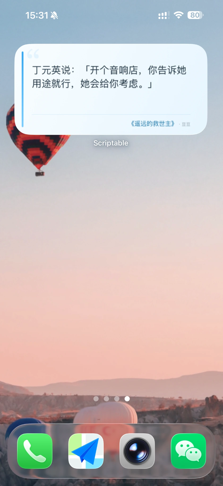
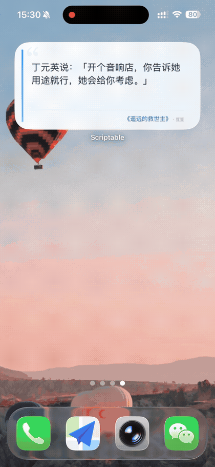
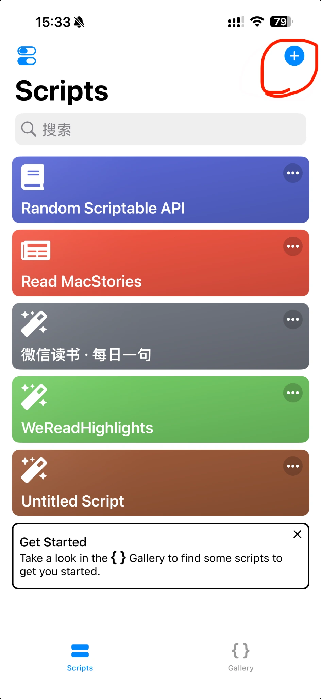
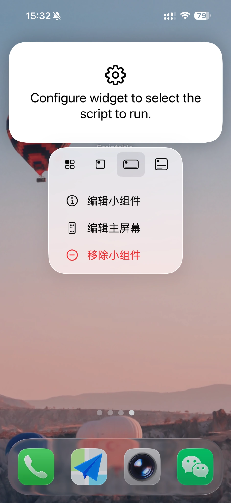
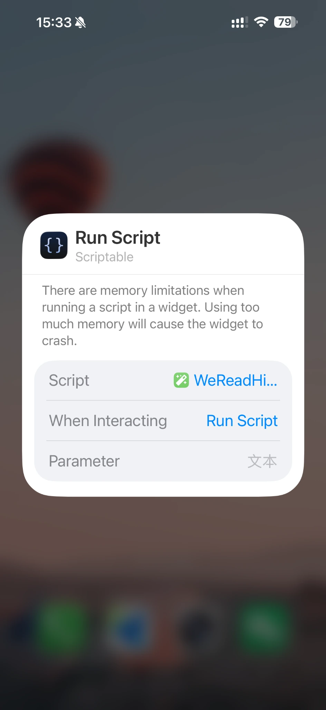

<div align="center">

# 📚 WeReadHighlights

**让读过的句子，再遇见你一次。**

把微信读书中曾经划过的句子带回桌面，随机回顾、定期更新，点击即可返回阅读上下文。

[](https://github.com/ma-tie/WeReadHighlights/releases/latest)
[](https://github.com/ma-tie/WeReadHighlights/releases/latest)
[](https://github.com/ma-tie/WeReadHighlights/releases/latest)
[](LICENSE)

**[下载最新版本](https://github.com/ma-tie/WeReadHighlights/releases/latest)** · [iOS 安装指南](#ios-安装) · [Android 安装指南](#android-安装) · [版本管理](#版本与发布)

</div>

---

## 项目介绍

WeReadHighlights 是一个开源的**微信读书个人划线桌面小组件**，支持 iOS 和 Android。

它会从你的微信读书划线中随机挑选一句，展示在主屏幕上。默认按 **4 小时**划分刷新时段，支持调整周期；点击小组件可尝试返回对应书籍或划线位置。

### ✨ 功能亮点

- 🎲 **随机回顾，常读常新**：从自己的微信读书划线中随机选取句子，按书籍划线数量加权抽取，让读过的内容有机会再次出现。
- ⏰ **按自己的节奏刷新**：默认每 4 小时更新一次，可设置 1 / 2 / 3 / 4 / 6 / 8 / 12 / 24 小时；实际刷新时间由手机系统调度。
- 📱 **三种桌面尺寸**：Small、Medium、Large 自由选择，适配不同的桌面空间；长句会按显示区域自动截断，不影响原文。
- 🎨 **清爽的阅读卡片**：浅蓝渐变、左侧蓝色竖线和淡色开引号，搭配正文、书名与作者，让划线自然融入桌面。
- 📖 **一键回到阅读上下文**：点击卡片即可尝试跳回微信读书；能否精确定位取决于划线数据和设备支持情况。
- ⚙️ **灵活的个性化设置**：调整刷新周期与文字显示效果，打造适合自己阅读习惯的小组件。
- 🔐 **本地安全存储**：API Key 加密或安全保存于设备，摘录保存在本地缓存，无须部署额外服务器。

## 效果展示

以下为**iOS / Scriptable** 的实际截图；Android 沿用类似的视觉风格，但使用原生小组件，实际尺寸和排版取决于手机的桌面启动器。

<div align="center">
  
  <p><sub>iOS 中号小组件</sub></p>
  
  <p><sub>iOS 点击跳转演示（不代表 Android 精确跳转已获验证）</sub></p>
</div>

---

## 下载与安装

从 **[GitHub Releases](https://github.com/ma-tie/WeReadHighlights/releases/latest)** 下载适合自己平台的文件。一个 Release 同时提供 iOS 脚本和 Android 正式签名 APK。

| 平台 | 下载文件 | 适用方式 |
| --- | --- | --- |
| **iOS** | `WeReadHighlights.js` | 在 Scriptable 中导入并添加小组件 |
| **Android** | `WeReadHighlights-Android-v<Android版本>.apk` | 安装独立 App 后添加小组件 |
| 校验 | `SHA256SUMS.txt` | 核对两个下载文件的 SHA-256 |

当前首个双平台正式版为 **[v0.2.3](https://github.com/ma-tie/WeReadHighlights/releases/tag/v0.2.3)**。

### 通用准备：微信读书 API Key

两个平台都需要你自己的微信读书 Skill API Key：

1. 打开 **[微信读书 Skills 页面](https://weread.qq.com/r/weread-skills)**；
2. 获取以 `wrk-` 开头的 API Key；
3. 首次运行 iOS 脚本或 Android App 时输入。

API Key 是个人访问凭据。**请勿将其写入公开仓库、发送给他人或放在截图中。** 项目直接请求微信读书 Skill Gateway，不需要自建服务端。

### iOS 安装

**要求：** iPhone、[Scriptable](https://apps.apple.com/us/app/scriptable/id1405459188) 和微信读书。

1. 安装并打开 Scriptable。
2. 从 [Releases](https://github.com/ma-tie/WeReadHighlights/releases/latest) 下载 `WeReadHighlights.js`，将脚本内容导入 Scriptable，保存为 `WeReadHighlights`。
3. 在 Scriptable 中**手动运行一次**，根据提示填写 API Key。脚本会读取划线并显示预览；凭据保存在本机 Keychain，之后不必重复填写。
4. 在 iPhone 主屏幕长按空白区域 → **添加小组件** → 搜索 **Scriptable** → 选择 Small、Medium 或 Large。
5. 长按刚添加的小组件 → **编辑小组件**，将 **Script** 设为 `WeReadHighlights`，**When Interacting** 保持 **Run Script**。

<div align="center">
  
  
  
  <p><sub>iOS 操作示例：创建脚本、编辑小组件、选择脚本</sub></p>
</div>

**调整刷新周期：** 在 `WeReadHighlights.js` 顶部修改：

```javascript
const REFRESH_INTERVAL_HOURS = 4;
```

支持 `1 / 2 / 3 / 4 / 6 / 8 / 12 / 24` 小时。该设置决定随机划线的**缓存时段**；实际小组件更新仍由 iOS 调度，不保证整点刷新。

### Android 安装

**要求：** Android 8.0（API 26）或更高版本、微信读书，以及允许安装下载的 APK。

1. 在 [Releases](https://github.com/ma-tie/WeReadHighlights/releases/latest) 下载名称包含 `Android` 的 **Release APK**（不是 Debug APK）。
2. 在手机中打开 APK，按系统提示允许该浏览器或文件管理器**安装未知应用**，完成安装。
3. 打开 **WeReadHighlights**，输入 `wrk-` 开头的 API Key，点击 **保存密钥并同步**。
4. 在 App 中根据需要设置**刷新周期**（1 / 2 / 3 / 4 / 6 / 8 / 12 / 24 小时）、**正文字号**（紧凑 / 标准 / 舒展）、**是否显示作者**。
5. 长按安卓桌面空白处 → **小组件 / Widgets** → 选择 **WeReadHighlights 小号、中号或大号**，拖到桌面。

Android 12 及以上版本中，三种组件的期望网格尺寸分别为 **2×2、4×2、4×4**；实际占用列数受桌面启动器设置影响，不保证所有品牌完全一致。App 中的 **换一句划线** 可以立即请求新的摘录。

**注意：** Android 后台刷新由 WorkManager 请求，省电策略可能延后执行。Android 版会尝试打开对应微信读书链接，但不同安卓设备与微信读书版本对精确定位的支持尚不能保证。

Android 专项开发、构建和问题排查见 **[android/README.md](android/README.md)**。

---

## 工作原理

```text
微信读书 Skill API
       ↓
读取有个人划线的书籍
       ↓
依据 noteCount 加权随机选书
       ↓
从书内个人划线随机抽取一句
       ↓
按当前刷新时段缓存
       ↓
iOS Scriptable / Android 原生 Widget 展示
       ↓
点击后尝试打开微信读书对应链接
```

选择书籍时，项目参考微信读书返回的 `noteCount` 进行加权，随后在选中书籍的有效划线中均匀抽取。这是为了尽量避免划线数量少的书与划线数量多的书获得相同的抽取机会；**若 `noteCount` 与实际可用划线数不同，并不保证每条划线严格等概率**。

不同刷新时段之间采用**有放回随机抽样**：前后两次可能出现同一句。若系统在同一个时段内反复更新，通常会复用缓存；Android App 中手动点击“换一句划线”则会主动重新抽取。

三种尺寸的正文会按可用空间截断，**不会修改原始划线数据**。Small 仅显示书名，Medium / Large 可以显示书名和作者。

## 版本与发布

本仓库将 **GitHub Release** 作为双平台的统一下载入口，但**平台版本号独立维护**：

| 版本类型 | 位置 | 何时更新 |
| --- | --- | --- |
| 整体发布批次 | 根目录 `VERSION`，Git 标签 `vX.Y.Z` | 任一平台有新版本需要发布时 |
| iOS 脚本版本 | `WeReadHighlights.js` 中的 `APP_VERSION` | iOS 脚本发生变化时 |
| Android 应用版本 | `android/app/build.gradle.kts` 中的 `versionName` / `versionCode` | Android 应用发生变化时，两个值都更新 |

例如，GitHub Release **v0.2.4** 可以包含 **iOS 0.2.4 + Android 0.2.3**。即使某个平台没有更新，Release 仍会附带它的当前稳定文件，便于用户在同一页面下载。

发布工作流会校验版本格式、构建并验证 Android 签名、附带 iOS 脚本与校验文件。正式发布由匹配 `VERSION` 的标签触发，或由特定的发布合并提交触发。

**发行说明及历史版本：** [GitHub Releases](https://github.com/ma-tie/WeReadHighlights/releases)。

## 隐私与安全

- iOS 的 API Key 与 `userVid` 保存在 Scriptable 可访问的 Keychain；Android API Key 通过 Android Keystore 保护并保存在本机。
- 个人划线缓存存放在各自设备的本地应用存储中；项目不要求注册额外账号或部署自有服务器。
- API Key 用于调用微信读书 Skill API，不应提交到 GitHub。若怀疑凭据泄露，建议立即更换。
- GitHub Releases 发布的是脚本与签名 APK，不包含用户的私人 API Key 或划线缓存。

## 常见问题

<details>
<summary><strong>为什么没有按设置的时间准点换句子？</strong></summary>

iOS 和 Android 都不能保证桌面小组件精确准点更新。iOS 根据系统策略安排刷新，Android 的 WorkManager 也会受到后台与省电策略限制。刷新周期更接近内容的缓存/更新频率，而不是严格定时器。

</details>

<details>
<summary><strong>为什么有时连续两次看到同一句话？</strong></summary>

项目采用有放回随机抽样，不同刷新时段之间可能抽到相同内容，这不是缓存错误。

</details>

<details>
<summary><strong>点击小组件为什么只打开书籍，没有精准定位到划线？</strong></summary>

精确跳转依赖 `bookId`、`chapterUid`、`range`、`userVid` 等字段。数据缺失时可能退化为书籍级跳转；Android 是否支持该深度链接，还取决于微信读书版本及系统处理方式。

</details>

<details>
<summary><strong>为什么长句子显示不全？</strong></summary>

小组件只展示当前尺寸能够容纳的内容，长句会显示省略号。Small / Medium 设计上最多约 4 行，Large 最多约 9 行；实际可见内容也会受到字体大小、设备尺寸和系统排版影响。

</details>

<details>
<summary><strong>为什么 Android 更新 APK 时提示安装失败？</strong></summary>

请先确认下载的是正式签名的 Release APK。Debug 版可能使用不同签名；如果提示 `INSTALL_FAILED_UPDATE_INCOMPATIBLE`，通常需要先卸载旧的 Debug 版，再安装正式版（会丢失该 App 的本地数据）。已安装正式版的用户通常可在相同包名与签名、较新 `versionCode` 下直接升级。

</details>

## 开发与贡献

```text
WeReadHighlights/
├── WeReadHighlights.js           # iOS / Scriptable
├── android/                      # Android / Kotlin 源码与构建说明
│   └── README.md
├── .github/workflows/            # Debug APK 和双平台签名发布
├── VERSION                       # GitHub Release 发布批次
├── docs/images/                  # iOS 截图与演示资源
├── tools/                        # iOS 源码 PDF 导出等维护工具
├── README.md
└── LICENSE
```

- **iOS 开发：** 修改仓库根目录 `WeReadHighlights.js`。
- **Android 开发：** 阅读 [Android 开发说明](android/README.md)，使用 Android Studio 或 Gradle 构建。
- **iOS 源码 PDF 导出（维护者工具）：** 安装 `tools/requirements.txt`，运行 `python3 tools/export_source_pdf.py` 生成 `WeReadHighlights.pdf`。生成的 PDF 不随每次发布自动附带。
- 欢迎通过 [Issues](https://github.com/ma-tie/WeReadHighlights/issues) 与 [Pull Requests](https://github.com/ma-tie/WeReadHighlights/pulls) 反馈问题或参与开发。

## 许可证

本项目基于 [MIT License](LICENSE) 开源。
